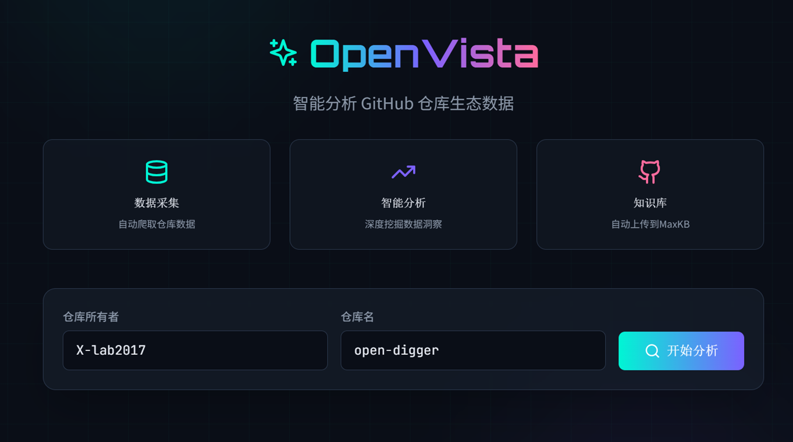
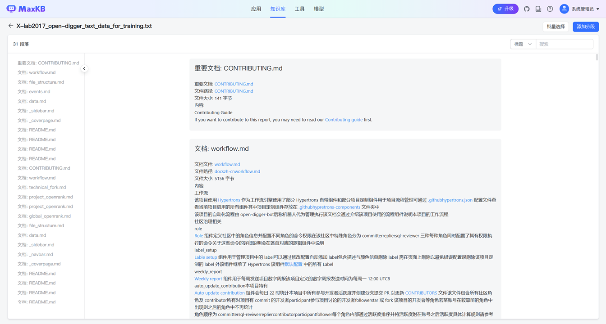
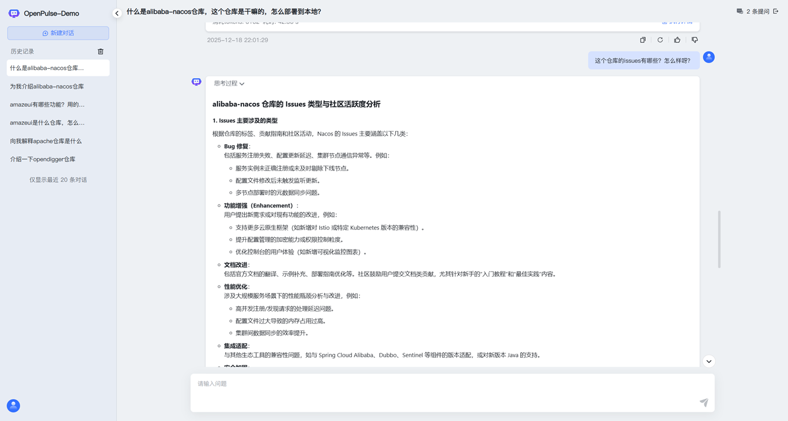
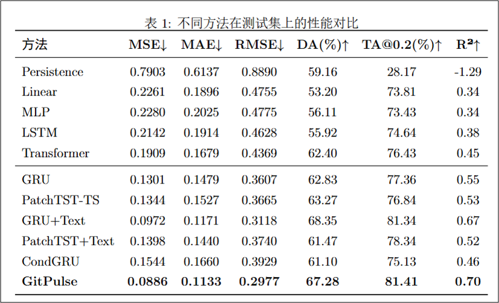
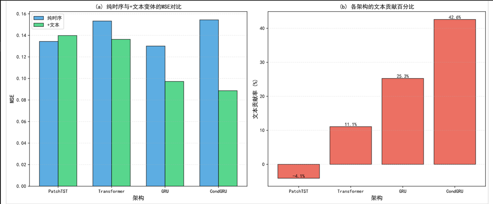
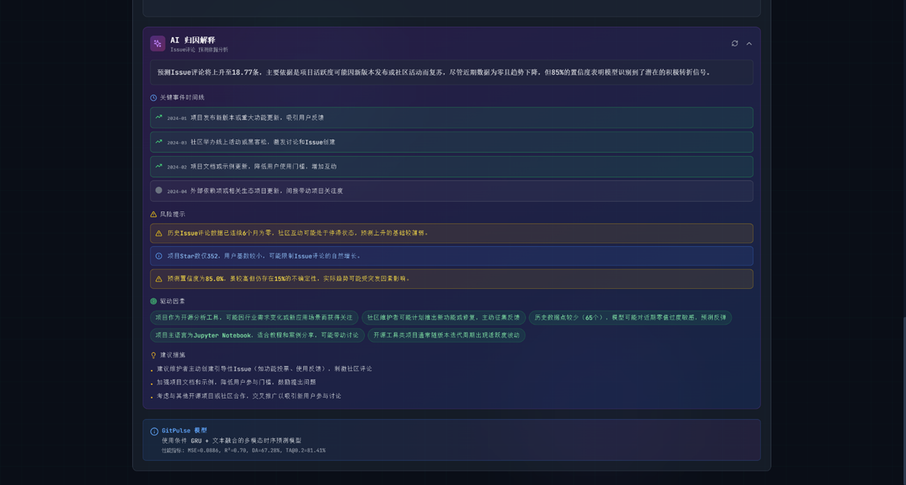
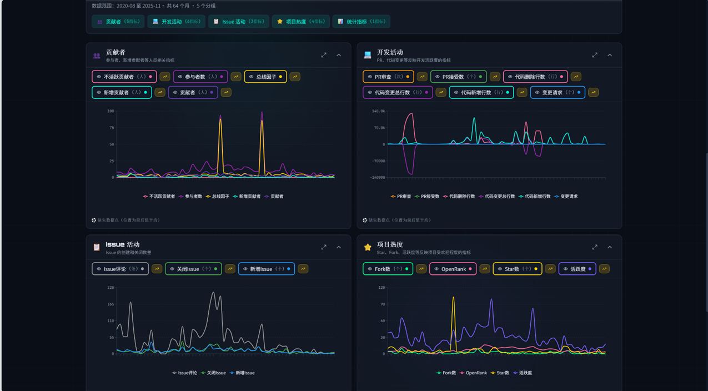
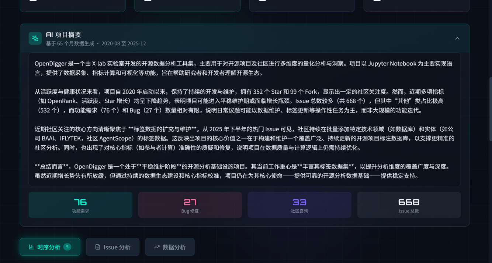

<div align="center">

# 🔮 OpenVista

### 基于多模态时序预测的 GitHub 仓库生态画像分析平台



<br/>

[](https://www.python.org/)
[](https://reactjs.org/)
[](https://pytorch.org/)
[](https://www.typescriptlang.org/)
[](LICENSE)

**[English](README.md)** · **[中文文档](README_CN.md)** 

</div>

---

## 🌟 项目概述

**OpenVista** 是新一代开源项目健康度分析与预测平台。平台集成两大核心能力：

1. **🤖 MaxKB 智能问答系统** — 基于 RAG 技术的项目知识库问答
2. **🔮 GitPulse 多模态预测模型** — 融合时序指标与文本信息的智能预测

通过这两大核心模块，OpenVista 能够全方位分析开源项目的历史、现状与未来。

---

### 💡 我们解决什么问题

开源项目在长期维护和可持续发展中面临诸多挑战。基于 **600+ 个 GitHub 仓库** 的实证研究，我们发现了项目健康度理解与预测中的关键盲点：

#### 🔴 当前痛点

1. **碎片化的健康评估**
   - 传统指标（Star 数、Commit 数）只能反映局部信息
   - 缺乏统一的框架全面评估项目健康状况
   - 难以识别项目衰退的早期预警信号

2. **不完整的预测模型**
   - 现有方法仅依赖时序指标（R² ≈ 0.46）
   - 忽略了丰富的文本信息（README、Issue、文档等）
   - 无法捕捉项目方向和社区参与的语义信号

3. **高协作摩擦成本**
   - Issue 描述不清晰增加维护负担
   - 文档不完善阻碍新贡献者参与
   - 缺乏结构化的健康度改进指导

4. **可执行洞察有限**
   - 原始指标难以转化为可执行的改进建议
   - 缺乏系统性的方法理解项目"为什么"表现不佳
   - 难以发现相似项目进行学习协作

#### ✅ 我们的解决方案

**OpenVista** 通过三大创新解决上述问题：

1. **多模态预测** — 融合时序指标与文本特征，预测准确率提升 **66.7%**（R²: 0.46 → 0.77）
2. **CHAOSS 健康评分** — 六维度评价框架提供全面的健康度评估
3. **智能问答** — 基于 RAG 的知识库，支持自然语言查询任意仓库

我们的平台将原始数据转化为可执行的洞察，帮助维护者、贡献者和组织做出数据驱动的开源项目决策。

#### 📊 实证发现

通过大规模数据分析，我们发现：

- **文本信息对预测的显著贡献**：融合文本特征后，模型解释力提升 66.7%
- **文档质量与项目健康度强相关**：清晰的 README、完善的贡献指南显著降低协作门槛
- **CHAOSS 框架的全面性**：多维度评估比单一指标（如 Star 数）更能反映真实健康状况
- **Issue 维护质量影响可持续性**：Issue 响应效率、标签体系等长期影响项目发展

---


## 📑 目录
- [🌟 项目概述](#-项目概述)
    - [📑 目录](#-目录)
    - [🛠️ 技术架构](#️-技术架构)
    - [📁 项目结构](#-项目结构)
    - [🚀 快速开始](#-快速开始)
    - [📖 使用指南](#-使用指南)
    - [🤖 MaxKB 智能问答系统](#-maxkb-智能问答系统)
      - [系统架构](#系统架构)
      - [知识库内容](#知识库内容)
      - [技术栈与工具](#技术栈与工具)
      - [MaxKB 初始化与配置](#maxkb-初始化与配置)
      - [使用方式](#使用方式)
    - [🔬 GitPulse 预测模型](#-gitpulse-预测模型)
      - [模型性能](#模型性能)
      - [支持的指标（共 16 个）](#支持的指标共-16-个)
      - [训练自己的模型](#训练自己的模型)
    - [✨ 功能亮点](#-功能亮点)
    - [🤝 贡献指南](#-贡献指南)
    - [📢 社区倡议](#-社区倡议)
    - [🙏 致谢](#-致谢)
## 🛠️ 技术架构

<div align="center">

</div>

<table>
<tr>
<td width="50%">

### 后端技术
- **框架**: Flask (Python)
- **深度学习**: PyTorch 2.0+
- **NLP**: Transformers (DistilBERT)
- **数据处理**: Pandas, NumPy

</td>
<td width="50%">

### 前端技术
- **框架**: React 18+ (TypeScript)
- **样式**: Tailwind CSS
- **图表**: Recharts + 自定义 SVG
- **动画**: Framer Motion

</td>
</tr>
<tr>
<td>

### AI 与知识库
- **RAG 系统**: MaxKB
- **LLM 备用**: DeepSeek API
- **文本编码**: DistilBERT

</td>
<td>

### 数据来源
- **GitHub API**: Issues、PRs、Commits
- **OpenDigger**: 16 个时序指标

</td>
</tr>
</table>

---

## 📁 项目结构

```
OpenVista/
├── 🔧 backend/                     # Flask 后端服务
│   ├── Agent/                      # AI 与 MaxKB 集成
│   │   ├── maxkb_client.py         # MaxKB 知识库客户端
│   │   ├── prediction_explainer.py # AI 预测解释器
│   │   └── qa_agent.py             # 智能问答 Agent
│   │
│   ├── DataProcessor/              # 数据爬取与处理
│   │   ├── crawl_monthly_data.py   # 主爬虫入口
│   │   ├── github_text_crawler.py  # GitHub 文本爬虫
│   │   ├── maxkb_uploader.py       # MaxKB 文档上传器
│   │   └── monthly_crawler.py      # OpenDigger 数据爬虫
│   │
│   ├── GitPulse/                   # GitPulse 预测模型
│   │   ├── model.py                # 模型架构定义
│   │   ├── prediction_service.py   # 预测服务
│   │   └── gitpulse_weights.pt     # 训练好的模型权重 (LFS)
│   │
│   ├── CHAOSSEvaluation/           # 社区健康度评分
│   │   └── chaoss_calculator.py    # CHAOSS 指标计算器
│   │
│   └── app.py                      # Flask API 入口
│
├── 🎨 frontend/                    # React 前端
│
├── 📊 get-dataset/                 # 训练数据集生成器
│
├── 🔬 GitPulse-Training/          # GitPulse 模型训练与复现
│   ├── model/                     # 模型架构定义
│   ├── training/                  # 训练脚本
│   ├── Fine-tuning/               # 微调实验
│   ├── predict/                   # 预测脚本
│   ├── ablation-test/             # 消融实验
│   ├── baseline-test/             # 基线对比实验
│   └── Pretrain-data/             # 训练数据集
│
├── 🐳 maxkb-export/                # MaxKB 部署配置
│   ├── install.sh                  # 一键安装脚本
│   ├── docker-compose.yml          # Docker 编排文件
│   └── db/                         # 数据库备份
│
└── 📄 README.md
```

---

## 🚀 快速开始

### 环境要求

- Python 3.8+
- Node.js 16+
- [Docker Desktop](https://www.docker.com/products/docker-desktop/)（用于 MaxKB）
- Git（自动安装 Git LFS）

### 🎯 一键安装（推荐）

我们提供了统一的安装脚本，自动完成所有配置：

**Windows PowerShell:**
```powershell
git clone https://github.com/your-username/OpenVista.git
cd OpenVista
.\setup.ps1
```

**Linux / macOS:**
```bash
git clone https://github.com/your-username/OpenVista.git
cd OpenVista
chmod +x setup.sh && ./setup.sh
```

安装脚本将自动完成：

| 步骤 | 说明 |
|------|------|
| 📦 Git LFS | 拉取模型权重、训练数据、知识库数据 |
| 🐳 Docker | 检测安装状态，引导安装 |
| 🤖 MaxKB | 一键部署知识库系统，自动恢复数据 |
| 🔑 GitHub Token | 交互式配置，自动验证有效性 |
| 📚 依赖安装 | Python/Node.js 依赖可选安装 |

---

### 📖 手动安装（高级用户）

<details>
<summary>点击展开手动安装步骤</summary>

#### 1️⃣ 克隆与初始化

```bash
git clone https://github.com/your-username/OpenVista.git
cd OpenVista

# 拉取大文件（模型权重、训练数据）
git lfs install
git lfs pull
```

#### 2️⃣ 部署 MaxKB

```bash
cd maxkb-export
chmod +x install.sh
./install.sh  # 或 Windows: .\install.ps1
```

访问 `http://localhost:8080` 验证 MaxKB 运行正常。

#### 3️⃣ 环境配置

在项目根目录创建 `.env` 文件：

```env
# GitHub API Token（必需）
GITHUB_TOKEN=your_github_token

# DeepSeek API Key（AI 功能）
DEEPSEEK_API_KEY=your_deepseek_key
```

#### 4️⃣ 安装依赖

```bash
# 后端依赖
cd backend
pip install -r requirements.txt

# 前端依赖
cd ../frontend
npm install
```

</details>

---

### 🚀 启动服务

```bash
# 终端 1：启动后端（端口 5000）
cd backend
python app.py

# 终端 2：启动前端（端口 3000）
cd frontend
npm run dev
```

### 🌐 访问平台

| 服务 | 地址 |
|------|------|
| 前端界面 | http://localhost:3000 |
| 后端 API | http://localhost:5000 |
| MaxKB 知识库 | http://localhost:8080 |

---

## 📖 使用指南

### 基本流程

1. **🔍 搜索仓库** — 输入 `owner/repo`（如 `facebook/react`）
2. **⏳ 等待爬取** — 从 GitHub API 和 OpenDigger 获取数据
3. **📊 探索分析** — 查看时序图表、Issue 分析
4. **🔮 查看预测** — 查看 12 个月预测及 AI 解释
5. **📈 CHAOSS 评估** — 评估社区健康度评分
6. **🤖 AI 问答** — 使用 MaxKB 询问关于仓库的问题

补充说明：Issue 分析、预测及 AI 解释、使用 MaxKB 等功能需等待爬取完成后才能正常使用；可通过前端页面下方进度条或后端查看爬取进度。完整项目数据会落在 `backend/DataProcessor/data/owner_repo/` 下，例如 `backend/DataProcessor/data/odoo_odoo/`，其中包含 `monthly_data_YYYYMMDD_HHMMSS/`，目录内通常包括 `metadata.json`、`raw_monthly_data.json`、`text_for_maxkb/`（README/License/docs 等）、`timeseries_for_model/`（按月 JSON 与汇总文件）等。

---

## 🤖 MaxKB 智能问答系统

<div align="center">

</div>

### 系统架构

MaxKB 是 OpenVista 的 **AI 问答核心**，采用 **RAG（检索增强生成）** 技术，让用户可以自然语言询问关于项目的任何问题。

```
用户问题 → MaxKB 检索知识库 → LLM 生成回答 → 返回结果
```

### 知识库内容

系统自动为每个分析的仓库构建知识库，包含：

| 文档类型 | 内容说明 |
|----------|----------|
| 📄 **README** | 项目介绍、安装指南、使用说明 |
| 📜 **LICENSE** | 开源许可证信息 |
| 📁 **docs/** | 项目文档目录下的所有文档 |
| 📊 **项目摘要** | AI 生成的项目分析报告 |
| 🐛 **Issue 汇总** | 抽样 Issue 数据（每月 30 条 × 最多 50 个月） |

### 技术栈与工具

| 组件 | 工具/技术 | 说明 |
|------|-----------|------|
| **知识库平台** | [MaxKB](https://github.com/1Panel-dev/MaxKB) | 开源 RAG 知识库系统 |
| **部署方式** | Docker Compose | 一键部署，支持数据持久化 |
| **向量数据库** | PostgreSQL + pgvector | 高效向量相似度检索 |
| **LLM 后端** | 可配置（DeepSeek/OpenAI 等） | 支持多种大模型 |

### MaxKB 初始化与配置

<details>
<summary>如果前面没有选择配置，这里可以单独配置 MaxKB 模块</summary>

#### 部署与配置

##### 方式一：使用预配置知识库（推荐）

**Windows PowerShell:**
```powershell
cd maxkb-export

# 一键安装（含数据库备份恢复）
.\install.ps1
```

**Linux / macOS:**
```bash
cd maxkb-export

# 一键安装（含数据库备份恢复）
chmod +x install.sh
./install.sh
```

> **说明**: `chmod +x` 是 Linux/Unix 命令，用于给脚本添加执行权限。Windows 用户请使用 `install.ps1` 脚本。

安装脚本会自动：
- 拉取 MaxKB Docker 镜像
- 创建数据卷并恢复预配置数据
- 启动服务在 `http://localhost:8080`

##### 方式二：全新安装

```bash
# 使用 Docker Compose 启动
docker-compose -f docker-compose.maxkb.yml up -d
```

</details>

安装完成后，打开 `http://localhost:8080`，界面应与下图一致：

<div align="center">

</div>

由于安装时已完成初始化，默认账号为：

- 用户名：`admin`
- 密码：`MaxKB@123456`

登录后请参考 [MaxKB 官方文档](https://maxkb.cn/docs/v2/) 完成以下步骤：

1. 创建知识库（用于存放上传的项目文档）
2. 创建“简单应用”，并将该应用关联到刚创建的知识库
3. 应用使用的 LLM 可在“模型”中由用户自行选择并配置，如需联网搜索功能，自行创建和配置相应“工具”

完成上述配置后，即可构建由 MaxKB 支持的 RAG 知识库系统。


#### 配置 .env 文件

在项目根目录创建 `.env` 文件，配置以下内容：

```env
# MaxKB 服务配置
MAXKB_URL=http://localhost:8080
MAXKB_USERNAME=admin
MAXKB_PASSWORD=your_password
MAXKB_KNOWLEDGE_ID=your_knowledge_id

# MaxKB AI API（用于问答）
MAXKB_AI_URL=http://localhost:8080/chat/api/019adeb1-9073-7320-bce2-295...
MAXKB_API_KEY=application-c527aa669276e38ab7880b1f43255c9a
```

<details>
<summary>📖 点击展开：如何获取 MaxKB API 配置值</summary>

### 如何获取 MaxKB API 配置值

配置好 MaxKB 后，需要将对应的 API 配置写入 `.env` 文件中：

#### 1. MAXKB_KNOWLEDGE_ID（知识库 ID）

**获取步骤：**

1. 登录 MaxKB（`http://localhost:8080`）
2. 在顶部菜单中点击 **知识库**
3. 创建新知识库或选择现有知识库
4. 点击进入知识库查看文档
5. 查看浏览器地址栏的 URL，格式如下：
   ```
   http://localhost:8080/admin/knowledge/019ae417-2fc017ed1652/default/document
   ```
6. 知识库 ID 就是 `/knowledge/` 和 `/default/` 之间的部分：
   - 在上面的例子中：`019ae417-2fc017ed1652`
   - 复制这个 ID 作为 `MAXKB_KNOWLEDGE_ID` 的值


#### 2. MAXKB_AI_URL（API 基础地址）

**获取步骤：**

1. 在 MaxKB 中，点击顶部菜单的 **应用**
2. 创建新应用或选择现有应用
3. 在应用概览页面，找到 **API 访问凭据** 部分
4. 复制 **Base URL** 的值，例如：
   ```
   http://localhost:8080/chat/api/019adeb1-9073-7320-bce2-295...
   ```
5. 将此值作为 `MAXKB_AI_URL` 的值


#### 3. MAXKB_API_KEY（API 密钥）

**创建步骤：**

1. 在同一应用概览页面，点击 **API Key** 按钮
2. 在 API Key 管理对话框中，点击 **创建**
3. 将生成一个新的 API 密钥，以 `application-` 开头，例如：
   ```
   application-c527aa669276e38ab7880b1f43255c9a
   ```
4. 点击复制图标复制 API 密钥
5. 将此值作为 `MAXKB_API_KEY` 的值


> **注意**：请妥善保管您的 API 密钥，不要将其提交到版本控制系统。`.env` 文件已在 `.gitignore` 中。

</details>

### 使用方式

1. **自动文档上传**：爬取仓库时自动将文档上传到 MaxKB
2. **智能问答**：在平台的 AI 问答模块中提问
3. **预测解释**：MaxKB 为预测结果生成可解释性分析

<div align="center">

</div>

---

## 🔬 GitPulse 预测模型

### 模型性能

<div align="center">

</div>

在 **4,232 个 数据（600+仓库滑动窗口生成）** 的 **636 个测试样本** 上评估（两阶段训练：预训练 + 微调）：

<div align="center">

| 模型 | MSE ↓ | MAE ↓ | R² ↑ | DA ↑ | TA@0.2 ↑ |
|:-----|:-----:|:-----:|:----:|:----:|:--------:|
| **GitPulse (Transformer+Text)** | **0.0712** | **0.1075** | **0.77** | **73.00%** | **81.75%** |
| CondGRU+Text | 0.0949 | 0.1243 | 0.69 | 68.56% | 79.55% |
| GRU+Text | 0.1084 | 0.1297 | 0.65 | 68.28% | 79.12% |
| Transformer | 0.1693 | 0.1667 | 0.46 | 62.22% | 75.97% |
| CondGRU | 0.1961 | 0.1872 | 0.44 | 61.49% | 74.39% |
| LSTM | 0.2142 | 0.1914 | 0.46 | 56.00% | 75.00% |
| MLP | 0.2280 | 0.2025 | 0.34 | 56.00% | 73.00% |
| Linear | 0.2261 | 0.1896 | 0.34 | 53.00% | 74.00% |

</div>

> **文本贡献**: 加入文本特征后，R² 从 0.46 提升到 0.77（**+66.7%**）

### 模型概述

**GitPulse** 是 OpenVista 的核心多模态时序预测模型，能够同时预测 16 个 OpenDigger 指标的未来走势。

<div align="center">

</div>

### 架构亮点

| 组件 | 技术 | 作用 |
|------|------|------|
| **时序编码器** | Transformer（2 层，4 头） | 捕捉 16 个指标的时序模式 |
| **文本编码器** | DistilBERT（冻结）+ 注意力池化 | 提取项目描述文本特征 |
| **融合层** | 交叉注意力 + 动态门控（0.1-0.3） | 文本引导时序特征融合 |
| **辅助任务** | 对比学习 + 匹配任务 | 提升文本-时序对齐 |
| **预测头** | MLP + 时间投影 | 输出未来 32 个月的预测值 |

<details>
<summary>📈 点击查看文本贡献效果</summary>

<div align="center">

</div>

</details>

### 模型参数

| 参数 | 数值 | 说明 |
|------|------|------|
| d_model | 128 | 模型隐藏维度 |
| n_heads | 4 | 多头注意力头数 |
| n_layers | 2 | Transformer 编码器层数 |
| hist_len | 128 个月 | 历史输入长度 |
| pred_len | 32 个月 | 预测时长 |
| n_vars | 16 | 指标数量 |
| text_weight | 0.1-0.3 | 动态文本贡献权重 |

### 两阶段训练

1. **预训练**: 多任务学习，包括 MSE + 对比学习损失（λ=0.1）+ 匹配任务损失（λ=0.05）
2. **微调**: 全参数微调，使用较低学习率（1e-5）

### 支持的指标（共 16 个）

| 类别 | 指标 |
|------|------|
| **影响力** | OpenRank、Star 数、Fork 数、关注度 |
| **活跃度** | 活跃度、参与者数、新增贡献者 |
| **贡献者** | 贡献者数、不活跃贡献者、总线因子 |
| **Issue** | 新增 Issue、关闭 Issue、Issue 评论 |
| **PR** | 变更请求、PR 接受数、PR 审查 |

### 训练自己的模型

```bash
cd get-dataset

# 生成数据集（默认：10,000 个仓库）
python generate_training_dataset.py --count 10000

# 从中断处继续
python generate_training_dataset.py --resume
```

详细说明请参考 [get-dataset/README.md](get-dataset/README.md)。

### 复现 GitPulse 模型

我们提供了完整的训练仓库 `GitPulse-Training/`，用于从零开始复现 GitPulse 模型。

#### 快速开始

```bash
cd GitPulse-Training

# 安装依赖
pip install -r requirements.txt

# 训练模型（两阶段训练）
cd training
python train_multimodal_v4_1.py --epochs 100 --batch_size 8

# 微调（获得最佳性能）
cd ../Fine-tuning
python finetune_all_v4_1.py \
    --pretrained_checkpoint ../training/checkpoints/best_model_transformer_mm.pt \
    --strategy full \
    --epochs 50 \
    --batch_size 8 \
    --lr 1e-5
```

#### 目录结构

```
GitPulse-Training/
├── model/                          # 模型架构定义
│   └── multimodal_ts_v4_1.py      # Transformer+Text 模型
├── training/                       # 训练脚本
│   ├── train_multimodal_v4_1.py   # 主训练脚本
│   └── checkpoints/               # 保存的模型权重
├── Fine-tuning/                   # 微调实验
│   └── results/                   # 微调后的模型
├── predict/                       # 预测脚本
│   └── predict_single_repo.py    # 单仓库预测脚本
├── ablation-test/                 # 消融实验
├── baseline-test/                 # 基线对比实验
├── merge-test/                    # 融合方法对比实验
├── Pretrain-data/                 # 训练数据集
│   └── github_multivar.json      # 多变量时序数据
├── evaluate_all_models.py         # 统一评估脚本
└── README.md                      # 详细训练指南
```

#### 核心特性

- **两阶段训练**：多任务学习预训练 + 全参数微调
- **完整实验**：消融实验、基线对比、融合方法测试
- **统一评估**：单一脚本评估所有模型，包含完整指标
- **生产就绪**：包含实际使用的预测脚本

详细的训练说明、模型架构和实验结果，请参考 [GitPulse-Training/README.md](GitPulse-Training/README.md)。

---

## ✨ 功能亮点

### 核心特性

| 功能 | 描述 |
|------|------|
| 🤖 **MaxKB 智能问答** | 基于项目文档的 RAG 知识库问答系统 |
| 🔮 **GitPulse 预测** | 时序指标 + 文本嵌入融合，预测未来 32 个月 |
| 📊 **CHAOSS 评估** | 社区健康度六维雷达图可视化评估 |
| 🔍 **相似仓库发现** | 基于 GitHub API 的多维度相似项目推荐 |
| 📈 **交互式可视化** | 精美图表，60+ 个月历史数据对比分析 |
| ⚡ **实时数据爬取** | 按需爬取任意 GitHub 仓库数据 |

<details>
<summary><b>🔮 智能趋势预测</b> - 12 个月预测与历史数据对比</summary>

<div align="center">

</div>

**AI 预测归因解释：**

<div align="center">

</div>

</details>

<details>
<summary><b>📊 时序可视化</b> - 多维度指标分析仪表盘</summary>

<div align="center">

</div>

</details>

<details>
<summary><b>🏥 CHAOSS 健康评价</b> - 六维雷达图分析</summary>

<div align="center">

</div>

### 评分算法

CHAOSS 评价采用多阶段评分算法，将 OpenDigger 的 16 个时序指标映射到 6 个评价维度。

#### 1. 指标归一化

对每个指标值进行归一化，将原始值映射到 0-100 分区间。支持三种归一化策略：

**策略一：百分位归一化（优先）**

对于配置了 `use_percentile=True` 的指标：

$$s_{\text{norm}} = \min\left(100, \frac{v}{P_{75}} \times 70\right)$$

其中：
- $v$ 为当前指标值
- $P_{75}$ 为历史数据的 75% 分位数
- 达到 $P_{75}$ 时得分为 70 分

**策略二：基准值归一化**

对于配置了基准值 `baseline` 的指标：

$$s_{\text{norm}} = \begin{cases}
60 \times \frac{v}{B} & \text{if } \frac{v}{B} < 1 \\
60 + 25 \times \left(\frac{v}{B} - 1\right) & \text{if } 1 \leq \frac{v}{B} < 2 \\
85 + 5 \times \left(\frac{v}{B} - 2\right) & \text{if } \frac{v}{B} \geq 2
\end{cases}$$

其中 $B$ 为基准值（对应 60 分的健康水平）。

**策略三：对数尺度归一化**

对于配置了 `log_scale=True` 的指标：

$$s_{\text{norm}} = \min\left(100, \log_{10}(1 + v) \times 50\right)$$

#### 2. 数据质量评估

对每个指标的历史数据评估质量得分 $q \in [0, 1]$：

$$q = 1 - \min(0.4, r_{\text{outlier}}) - \min(0.3, \max(0, r_{\text{zero}} - 0.3) \times 0.5)$$

其中：
- $r_{\text{outlier}}$ 为异常值比例（基于 IQR 方法检测）
- $r_{\text{zero}}$ 为零值比例

异常值检测使用 IQR（四分位距）方法：

$$\text{outlier} = \{v \mid v < Q_1 - k \times \text{IQR} \text{ 或 } v > Q_3 + k \times \text{IQR}\}$$

其中 $k$ 为 IQR 倍数（根据指标类型设置，通常为 1.5-2.5）。

#### 3. 质量折损应用

将数据质量应用于归一化得分：

$$s_{\text{quality}} = s_{\text{norm}} \times (0.7 + 0.3 \times q)$$

最多扣 30%，避免系统性压分。

#### 4. 维度得分计算

对每个维度，计算加权平均：

$$S_d = \frac{\sum_{i=1}^{n} s_i \times w_i}{\sum_{i=1}^{n} w_i}$$

其中：
- $S_d$ 为维度 $d$ 的得分
- $s_i$ 为指标 $i$ 的质量调整后得分
- $w_i$ 为指标 $i$ 的权重
- $n$ 为维度内的指标数量

应用健康软下限：

$$S_d' = \max(30, S_d)$$

#### 5. 月度评分

对最近 12 个月（或所有可用月份）的数据，按月计算各维度得分，得到月度评分序列：

$$\{S_{d,t}\}_{t=1}^{T}$$

其中 $T$ 为评估月份数（最多 12 个月）。

#### 6. 异常值处理与最终评分

对月度评分序列，使用改进的 IQR 方法去除异常值，计算最终得分：

对于维度得分序列 $\{S_{d,1}, S_{d,2}, \ldots, S_{d,T}\}$：

1. 计算 IQR：$\text{IQR} = Q_3 - Q_1$
2. 识别异常值：超出 $[Q_1 - 1.5 \times \text{IQR}, Q_3 + 1.5 \times \text{IQR}]$ 的值
3. 计算最终得分：对非异常值取平均

$$S_d^{\text{final}} = \frac{1}{|\mathcal{V}|} \sum_{t \in \mathcal{V}} S_{d,t}$$

其中 $\mathcal{V}$ 为非异常值的月份集合。

#### 7. 总体评分

计算所有维度的平均得分：

$$S_{\text{overall}} = \frac{1}{D} \sum_{d=1}^{D} S_d^{\text{final}}$$

其中 $D = 6$ 为维度数量。

</details>

<details>
<summary><b>🤖 AI 智能摘要</b> - 项目分析与相似仓库推荐</summary>

<div align="center">

</div>

</details>

<details>
<summary><b>🐛 Issue 智能分析</b> - 分类统计与趋势分析</summary>

<div align="center">

</div>

**分类统计饼图：**

<div align="center">

</div>

</details>

<details>
<summary><b>📖 内置技术文档</b> - 技术文档与 API 参考</summary>

<div align="center">

</div>

</details>

---

## 🤝 贡献指南

欢迎贡献代码！请按以下步骤操作：

1. Fork 本仓库
2. 创建功能分支 (`git checkout -b feature/AmazingFeature`)
3. 提交更改 (`git commit -m 'Add AmazingFeature'`)
4. 推送到分支 (`git push origin feature/AmazingFeature`)
5. 发起 Pull Request

---

## 📢 社区倡议

基于我们的研究发现，我们发布了一份**面向开源生态的实践倡议**，呼吁整个开源生态将文本信息质量（文档、Issue 描述等）提升到项目治理的核心位置。

**核心观点**：写好文档、规范 Issue、完善描述，不是可选项，而是项目可持续发展的必要保障。在 AI 时代，这些结构化的文本信息正在成为降低贡献门槛的关键工具。当文档清晰完整时，AI 代码助手可以更好地理解项目上下文；当 Issue 描述规范详细时，AI 可以自动分类、提取关键信息、推荐解决方案；当文档体系完善时，基于 RAG 的智能问答系统可以让任何人通过自然语言快速获取项目知识。

📖 **阅读完整倡议书**：[doc/倡议书/倡议书.md](../倡议书/倡议书.md)

倡议书包含：
- 基于 600+ 个 GitHub 项目的实证发现
- 面向维护者、贡献者、组织机构和平台开发者的实践建议
- 强调 AI 辅助协作和知识管理的重要性

---

## 🙏 致谢

- [MaxKB](https://github.com/1Panel-dev/MaxKB) — RAG 知识库系统
- [OpenDigger](https://github.com/X-lab2017/open-digger) — 时序指标数据来源
- [CHAOSS](https://chaoss.community/) — 社区健康度指标框架
- [GitHub API](https://docs.github.com/en/rest) — 仓库数据来源

---

## 👥 项目分工

### 个人独立完成部分

- **autu-mn**：PPT 制作、项目方案书撰写、CHAOSS 评价算法设计与实现
- **LuYuan-Zjyy**：GitPulse 预测模型设计与实现、前后端链接与集成

### 其余部分均为共同合作完成。

---

<div align="center">

### ⭐ 如果这个项目对你有帮助，请给个 Star！⭐

<br/>

**Made with ❤️ by OpenVista Team**

*用预测智能赋能开源社区*

</div>
